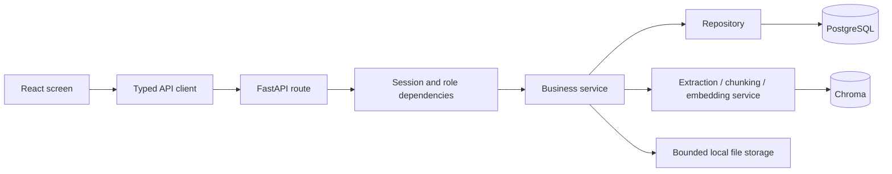

# Admin corpus management and React console

Current extension: the admin **User feedback** dashboard now reviews users,
conversations, exact linked turns, citations, retained context and thumbs ratings.
See [ADMIN_REVIEW_GUIDE.md](ADMIN_REVIEW_GUIDE.md). The sections below describe
the original corpus-management implementation. Aggregate analytics, profile,
category maintenance, date/version filters and feedback audit events are now
implemented; see [ADMIN_ANALYTICS_PROFILE_GUIDE.md](ADMIN_ANALYTICS_PROFILE_GUIDE.md).
The remaining historical scope exclusions below describe
that original slice, rather than every feature now implemented in the project.

Implemented against the supplied internship specification's authentication,
admin document workflow and service/repository architecture sections (§27–31).
This extends the working ingestion/retrieval pipeline. It does not implement
the rest of the specification's LLM generation, ticketing or formal evaluation
milestones.

## Plan and delivered behavior

1. **Add account authentication and enforce roles on the server.** Existing
   `users` rows retain their roles. New accounts use Argon2id hashes (64 MiB,
   3 passes, 4 lanes). Existing bcrypt hashes remain verifiable and upgrade to
   Argon2id after a successful login; older Argon2 settings also rehash on login.
   Failed login does not rewrite a hash. New passwords must contain 10–256
   characters; the legacy bcrypt verifier still enforces its 72-byte limit.
   Login creates an eight-hour revocable opaque session in an HttpOnly cookie;
   PostgreSQL stores only its SHA-256 digest. Logout revokes that session.
   Employee sessions cannot call admin APIs even if they manually construct
   requests or alter the frontend.
2. **Reuse extraction and versioned ingestion for corpus changes.** Admins can
   upload PDF/DOCX/TXT/MD, choose a category, inspect evidence, download the
   original, replace the source and rebuild its index. Immutable source files
   use random server-generated names. Files are limited to 20 MiB, and the
   request stream is capped before unlimited multipart spooling is possible.
3. **Separate availability from processing state.** `is_online` controls search
   eligibility independently of `staging/active/deactivated/failed`. An offline
   source retains its file, chunks and vectors. Both roles' search excludes it.
   Taking it online verifies its vectors first. Replacement and reindex inherit
   availability, including changes committed during staging.
4. **Make changes traceable and safe under failure.** Replacement/reindex use
   the same category/source identity. Stale admin requests return 409 rather
   than overwriting a newer version. Publication and its success audit event
   share one PostgreSQL transaction; audit failure preserves the old version.
   Existing vector recovery remains available through the reconciliation CLI.
5. **Provide a small React interface using actual API data.** Knowledge base
   displays current sources, counts, name/category/type/status filters, availability and maintenance
   actions. The inspector shows exact chunks, offsets, PDF pages/sections,
   warnings, versions and stored configuration. Retrieval lab shows matching
   evidence with similarity scores. Activity shows actual server audit events.
   Employees see Retrieval lab; admins also see corpus management and activity.
6. **Validate API, stores and browser behavior.** Real integration tests use
   temporary PostgreSQL schemas, Chroma and upload directories. Browser checks
   exercise the running app, including a fictional demonstration policy. No
   existing source is silently reingested or replaced during setup.

Here, online/offline means searchable availability. Website fetching or URL
ingestion is not part of this feature.

## Structure and request flow

```text
frontend/src/                   React screens and typed API client
backend/main.py                Application composition and middleware
backend/api/                   Thin HTTP routes and permission dependencies
backend/models/api_models.py   Validated HTTP inputs
backend/services/              Authentication, corpus operations, search, audit
backend/repositories/          PostgreSQL queries and row changes
backend/database/              SQLAlchemy mappings, connection, migrations
backend/utils/                 Hashing, bounded storage, extraction, chunking
data/uploads/                  Private immutable uploaded files (Git-ignored)
chroma_db/                     Existing local vector index
tests/                         Unit and isolated integration tests
evaluation/                    Existing location for the next gold-data work
```



Routes deserialize inputs and delegate. Services own workflow and transaction
decisions. Repositories query/flush without independently committing. Existing
`DocumentProcessingService` owns staging, publication and recovery. The
application injects request-scoped database sessions and cached model/vector
resources, making integration tests independent of the live corpus.

## Backend file and import map

The table lists meaningful dependencies: Python standard-library helpers such
as `uuid`, `datetime` and `pathlib` supply identities, UTC times and safe paths.

| File | Main imports and purpose |
| --- | --- |
| `backend/main.py` | FastAPI, CORS/static responses, API routers, connection factory, domain errors, `FileStorage`, `RequestBodyLimitMiddleware`. Composes the app, dependencies, API/static serving, error handling and request protections. |
| `backend/models/api_models.py` | Pydantic models/fields/validator. Rejects unknown JSON fields and validates login, availability, chunk settings and search inputs. |
| `backend/api/dependencies.py` | FastAPI `Depends`, `AuthService`, `DocumentService`. Resolves the current user, rejects missing sessions/non-admins and yields request services. |
| `backend/api/auth.py` | Dependency helpers, request model, FastAPI response tools. Login/me/logout routes; serializes safe user fields and manages the cookie. |
| `backend/api/documents.py` | `UploadFile`, `Form`, `FileResponse`, permission dependencies, request models. Thin upload/detail/replace/reindex/availability/download endpoints. |
| `backend/api/search.py` | Search model, current-user dependency, `SearchService`. Both roles can request evidence search. |
| `backend/api/audit.py` | Admin dependency and `AuditService`. Reads bounded recent audit activity. |
| `backend/services/auth_service.py` | User/session repositories, security helpers, session factory. Verifies login, creates/revokes sessions and checks current DB roles. |
| `backend/services/document_service.py` | Document/category repositories, processing service, audit service, file storage. Owns corpus workflow, source/version checks, DTOs and availability. |
| `backend/services/search_service.py` | Existing processing/retrieval service. Validates the question workflow and reports real elapsed time and evidence. |
| `backend/services/audit_service.py` | Audit repository. Bounds/sanitizes audit details; records in the caller's transaction and returns UTC activity DTOs. |
| `backend/services/document_processing_service.py` | Existing loaders/chunker, repositories and lazy embedding/retrieval services. Adds inherited availability, explicit reindex, selected-version checks and an audit callback inside publication. |
| `backend/repositories/user_repository.py` | SQLAlchemy `User`. Normalized email lookup and account creation. |
| `backend/repositories/auth_session_repository.py` | SQLAlchemy `AuthSession`. Creates, looks up valid digests and revokes sessions. |
| `backend/repositories/audit_repository.py` | `AuditLog`/`User`. Inserts events and joins actor email for activity. |
| `backend/repositories/document_management_repository.py` | Existing document/chunk/job/category models. Reads current/history/detail counts, checks file references and updates availability. |
| `backend/repositories/document_repository.py` | Existing document mapping. Source locks, version queries and online active-source eligibility. |
| `backend/repositories/chunk_repository.py` | Existing document/chunk mappings. Search requires active chunks belonging to active online documents. |
| `backend/database/models.py` | SQLAlchemy and PostgreSQL JSONB/UUID types. Adds `AuthSession`, `AuditLog` mapping/details and `Document.is_online`. |
| `backend/database/migrations/004_admin_console.sql` | Additive SQL. Adds availability, session table/indexes and JSON audit details without resetting existing rows. |
| `backend/database/main_schema.sql` | Fresh-install SQL equivalent. Existing installations use migrations rather than rerunning this schema. |
| `backend/utils/security.py` | argon2-cffi, bcrypt (legacy verification only), secrets, hashlib. Argon2id password hashing, migration checks, and cryptographically random session tokens with stored digests. |
| `backend/utils/file_storage.py` | Path, ntpath, uuid. Filename confinement, extension and file-size checks, immutable writes and bounded cleanup/download resolution. |
| `backend/utils/request_limits.py` | Starlette HTTP errors/responses. Rejects oversized Content-Length and counts bytes in streamed requests before file parsing. |
| `scripts/create_user.py` | Argparse, getpass, security/repositories/connection. Creates explicit admin/employee accounts without hardcoded credentials. |
| `scripts/apply_ingestion_migrations.py` | Existing backup/connection helpers. Takes a full private `pg_dump` backup, then applies sorted migrations including 004. |
| `scripts/verify_stores.py` | Existing SQLAlchemy/Chroma audit. Treats offline retained vectors as valid storage and legacy provenance as unknown. |
| `tests/test_admin_console.py` | FastAPI TestClient, isolated store fixtures, real extraction/model/index. Covers HTTP security, source changes, failures, races and migration preservation. |
| `tests/test_request_limits.py` | Minimal FastAPI apps and TestClient. Verifies Content-Length and streamed/multipart limits without using the project database. |

Frontend component/import responsibilities are listed in
[`frontend/README.md`](frontend/README.md). React manages state and renders
screens; `src/api.ts` owns fetch/cookie/error behavior; `src/types.ts` describes
responses; Lucide supplies icons; Vite builds TypeScript and proxies local API
requests. No database or embedding business logic lives in React.

## API reference

All document-management endpoints require an admin session unless noted.
Mutating browser requests use `X-Requested-With: helpdesk-ui` and a trusted
Origin. Cookies are HttpOnly and SameSite=Lax. No user-facing API accepts a role
from the login request.

| Method and path | Purpose |
| --- | --- |
| `GET /api/health` | Public process health, not a database/index readiness guarantee |
| `POST /api/auth/login` | Email/password login |
| `GET /api/auth/me` | Current signed-in identity |
| `POST /api/auth/logout` | Revoke the current session |
| `GET /api/documents` | Current source list and actual counts |
| `GET /api/documents/categories` | Existing categories |
| `POST /api/documents/upload` | Multipart file, category_id, optional name and initial is_online |
| `GET /api/documents/{id}` | Chunks, source metadata, warnings, history and configuration |
| `POST /api/documents/{id}/replace` | Multipart replacement under the same source identity |
| `POST /api/documents/{id}/reindex` | Rebuild stored source as a new version with chunk_size/overlap |
| `PATCH /api/documents/{id}/availability` | Set is_online without deleting evidence |
| `GET /api/documents/{id}/file` | Protected source download; employees only current online versions |
| `POST /api/search` | Both roles; actual eligible evidence, no generated answer |
| `GET /api/audit-logs` | Recent administrative audit events |

## Start and try it

Run from the repository root in PowerShell:

```powershell
.\venv\Scripts\python.exe -m pip install -r requirements_utf8.txt
.\venv\Scripts\python.exe -m scripts.apply_ingestion_migrations
npm --prefix frontend ci
npm --prefix frontend run build
.\venv\Scripts\python.exe -m uvicorn backend.main:app --host 127.0.0.1 --port 8000
```

Open `http://127.0.0.1:8000`. For active React development run
`npm --prefix frontend run dev` in a second terminal and use port 5173.
The local admin email is `admin@helpdesk.local`; the private generated password
is in ignored `output/local_admin_credentials.json`. Do not copy it into source
code, screenshots, handoff text or Git. For another account:

```powershell
.\venv\Scripts\python.exe -m scripts.create_user --email person@example.com --role employee
```

Use Add document, select a category and supported file, then inspect its chunks.
Make it offline and search for its evidence: that source will be excluded.
Replace file to create a new version; it stays offline. Rebuild index from the
Pipeline tab when chunk settings change. Make it online to retrieve the new
evidence. View Activity for the corresponding audit records.

## Validation and remaining scope

API cases include admin/employee enforcement; login/logout/expiry/replay;
PDF/DOCX/MD/TXT extraction; invalid/empty/oversized uploads; initial offline
publication; online/offline search; protected downloads; replacement and forced
reindex; duplicate file cleanup; source path confinement; stale version 409;
failure of audit during publication; availability changes during staging; and
repeatable migration 004 preserving existing credentials, roles and evidence.
Frontend tests cover typed fetch/session/error behavior. The build type-checks
the React app. Browser results and screenshots are under
`output/admin_console_validation/`; full backend output is
`output/admin_full_test_run.txt`.

Final verification: **125 backend tests passed**, including **27 admin API
integration cases** and **8 request-limit cases**. **8 frontend client tests
passed** and the production build succeeded. The browser workflow passed all
13 checks, including the corpus lifecycle, filters, mobile layout, session
revocation and the built app served on port 8000. The live store audit found
no failures; six pre-existing legacy documents retain unknown provenance.

## Week-by-week position in the internship plan

The specification's actual 10–12 week plan is on pages 13–16. A later feature
being built early does not complete every preceding week.

| Week | Added in this session | Overall remaining requirement |
| --- | --- | --- |
| 1: Requirements/foundations | Checked specification and documented architecture/plan | Learning and mentor sign-off are not established by code. Prior proposal/repository already existed. |
| 2: Python/APIs/processing | Running FastAPI environment and additive schema migration | Core parser/metadata/schema already implemented earlier; original extraction limits remain documented. |
| 3: Chunking/embeddings | UI shows tokens, chunks and config; reindex supports changed settings | Modules existed earlier. Controlled chunk-size/overlap comparison and experiment notes remain. |
| 4: Vector/retrieval | Retrieval GUI; authoritative online filtering; protected source access | Existing real-store quality results remain the foundation. Representative approved-corpus evaluation is still needed. |
| 5: First RAG prototype | Existing evidence can now be searched visually | Context construction, prompt template, LLM answers and hallucination tests remain. This is the next missing core milestone. |
| 6: Backend application | Auth/roles, document APIs, search/audit APIs, OpenAPI and real API tests | Chat and conversation APIs are missing, so the full week is partial. |
| 7: Frontend | React/TypeScript login, admin management/details, evidence/source view, activity | Answer chat and feedback are missing, so the full week is partial. |
| 8: Evaluation/quality | More corpus/version traceability and regression coverage | Formal 30–50-question gold set, answer-quality/hallucination report and configuration comparison remain. Prior synthetic questions are diagnostics, not the final gold set. |
| 9: Analytics/improvements | Admin screens, errors, version history and audit activity | Feedback/usage analytics and conversation history remain. Corpus counts are not a usage analytics dashboard. |
| 10: Testing/hardening | API/role/session/upload/race/failure/security tests; browser testing and fixes | AI-response/performance evaluation, final defect log and full release candidate remain. |
| 11–12: Finalization | Setup guide, file/import map, appended handoff and local running demo | Full deployment, final presentation and complete project demo remain. |

Separate requirements advanced here include §9 ingestion validation, §19 admin
management, §21 basic document filtering, §24 audit, §27 authentication/RBAC,
the implemented subset of §28 APIs, §29 service/repository architecture,
admin/login/detail parts of §30 screens, §31 folder layout and the relevant
conventional testing in §36. Permanent deletion and `DELETE /documents/{id}`
are not implemented: the reversible offline action provides deactivation via
the availability endpoint. Usage/feedback analytics, chat and profile screens
remain outside this session's delivered slice.

Setup applied 002/003/004 after a full backup:
`output/backups/before_helpdesk_migrations_20261022_202519.dump`.
Existing legacy rows were retained. Browser validation added one clearly named
fictional source, `Demo - Remote access policy`, with upload/replacement/reindex
history. Its content is a test fixture rather than company policy.

Remaining work includes golden questions/evidence labels against an approved
versioned corpus, held-out retrieval evaluation, LLM answer generation and
citations, refusal evaluation, chat/ticket workflows and the rest of the
specification. This console is a local synchronous implementation: it has no
background queue, live job progress stream, OCR, URL crawler, password-reset
workflow or public deployment setup. Production access controls and operational
monitoring still need deployment-specific design.
