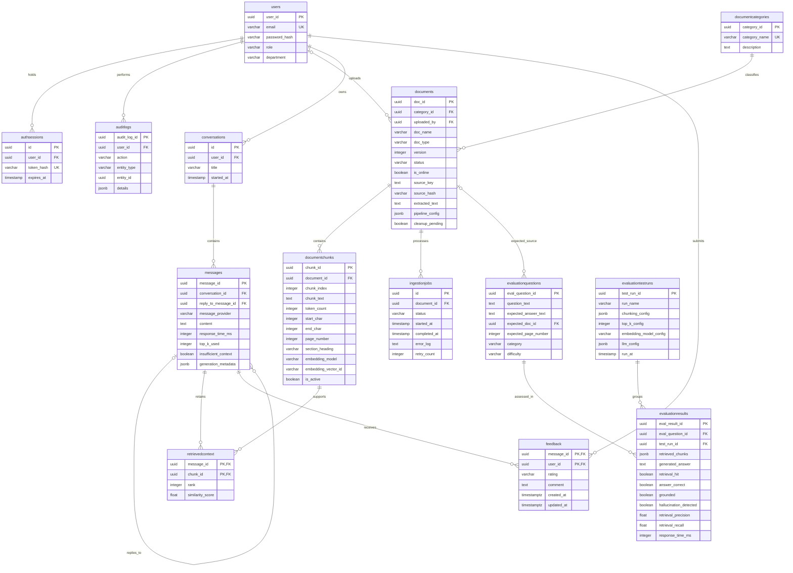

# AI Helpdesk Knowledge Workspace

React/TypeScript and FastAPI RAG helpdesk with PostgreSQL, Chroma, document administration, source-backed answers, owned history, feedback and analytics.

## Operational Scope and Limitations

Source files require explicit ingestion and indexing before they can support answers. Files are not automatically ingested at startup. Regression inputs in tests/fixtures/documents are separate from the operational knowledge corpus.

Table handling is not reliable yet. Extraction can read table text, but token-window chunking can split rows. Atomic tables, row-aware splitting and repeated headers are not implemented. Prefer prose and inspect extracted evidence.

Department is account metadata only; departmental document restrictions and multi-company isolation are not implemented. Formal evaluation and release hardening remain pending. Similarity scores are not confidence probabilities.

## Setup and launch

Use PowerShell from this project root:

```powershell
python -m venv venv
.\venv\Scripts\python.exe -m pip install -r requirements_utf8.txt
npm --prefix frontend ci
npm --prefix frontend run build
```

Provision PostgreSQL and an application role. For a new database use backend/database/main_schema.sql; existing databases require additive migrations rather than rerunning the schema. Configure fields from .env.example in ignored .env. The scripts.apply_ingestion_migrations tool creates backups as part of its normal operation.

The all-MiniLM-L6-v2 embedding model must be cached locally. Initial download is an explicit setup step through preview/ingestion CLI --allow-model-download. Optional OCR has separate requirements_ocr.txt and an isolated environment.

```powershell
.\venv\Scripts\python.exe -m scripts.create_user --email admin@example.com --role admin
.\venv\Scripts\python.exe -m uvicorn backend.main:app --host 127.0.0.1 --port 8006
```

Open http://127.0.0.1:8006/ in a browser. API documentation: http://127.0.0.1:8006/docs. FastAPI serves frontend/dist and /api. For frontend development use backend port8000 and npm --prefix frontend run dev, then open http://127.0.0.1:5173/. Use the same host consistently for cookies.

## Docker deployment

For a separate container-based installation, see the [Docker setup guide](docker/README.md).
It includes a frontend/backend image, PostgreSQL, persistent storage and optional
Groq generation through a mounted private key file. Docker uses port 8080 and
its own stores; existing local data and the root `.env` are not migrated or modified.

## Add new knowledge

Admin uploads accept PDF, DOCX, TXT and Markdown up to20MiB. Processing extracts text, chunks, generates embeddings, verifies vectors and publishes the document. Source files must be processed before retrieval. Default chunk/overlap:200/40model tokens. Offline documents are retained but excluded from fresh retrieval.

Knowledge Search supports vector, BM25 and hybrid modes. RETRIEVAL_MODE sets the server default. Experiments separately compare chunk/overlap/TopK using isolated cosine retrieval. Local retrieval works offline; external answer generation requires connectivity. Main prompt/schema: backend/prompts/rag_prompts.py; bounded follow-up rewriting: backend/services/query_rewrite_service.py.

## Checks

```powershell
.\venv\Scripts\python.exe -m pytest -q
.\venv\Scripts\python.exe -m pytest --run-integration -q
npm --prefix frontend test
npm --prefix frontend run build
```

Integration tests use disposable database schemas and require PostgreSQL and cached dependencies. Keep credentials, source uploads, private corpora, vector data and local reference material out of Git. Ignore rules do not remove older commits.

## Database Schema

PostgreSQL stores application identity, document provenance, conversation history, feedback, audit events and evaluation records. The diagram below reflects the current public schema inspected on 8 November 2026. It shows primary keys, foreign keys and selected descriptive fields; it is not a complete column listing. UUIDs identify records. `PK` denotes a primary key, `FK` a foreign key and `UK` a unique key. Crow's-foot connections represent one-to-many relationships; optional endpoints indicate nullable references.



### Table Responsibilities

| Area | Tables | Responsibility |
| --- | --- | --- |
| Identity and authentication | `users`, `authsessions` | Accounts, roles and revocable cookie sessions. Password hashes and session-token hashes are stored rather than plaintext credentials. Department is descriptive metadata, not an enforced content-access boundary. |
| Knowledge and provenance | `documentcategories`, `documents`, `documentchunks` | Categories, immutable source versions, extracted text, checksums, processing settings and exact chunk locations. A document row represents a version, not an entire version history. |
| Processing operations | `ingestionjobs` | Processing state, timestamps, failure details and recorded failure/retry counters. The table does not itself provide a durable background worker or automatic retry service. |
| Conversations and evidence | `conversations`, `messages`, `retrievedcontext` | Owned transcripts, exact question-to-answer links and the chunks retained for each response. Generation metadata stores citations and diagnostic information. |
| User feedback | `feedback` | One current rating per message/user pair, with an optional explanation. Stored `up`/`down` values are displayed as Positive/Negative. The composite primary key prevents duplicate current votes for that pair. |
| Operational audit | `auditlogs` | Actor, action, affected entity and selected details. `entity_type` plus `entity_id` is an application-level reference; `entity_id` is not a foreign key to every possible entity table. |
| Evaluation foundation | `evaluationquestions`, `evaluationtestruns`, `evaluationresults` | Expected sources/answers, run configurations and per-question outcomes. Existing schema capacity does not imply that a reviewed golden dataset or complete evaluation runner has been implemented. |

### Legacy Database Reference Material

The [`database_old`](database_old/) and [`databse schema_old_planning`](databse%20schema_old_planning/) directories contain historical database implementation and schema-planning material retained for reference. They document earlier design iterations and are not the authoritative source for the current application schema. Use `backend/database/main_schema.sql` and its additive migrations for the maintained schema, together with the application mappings in `backend/database/models.py`.

Schema sources: [`main_schema.sql`](backend/database/main_schema.sql), additive SQL files under [`migrations`](backend/database/migrations/), and application mappings in [`models.py`](backend/database/models.py). The three evaluation tables are present in the SQL schema but are not mapped as ORM classes in the current `models.py`.

## ABC CORP Knowledge Corpus

The corpus contains **35 documents** covering service operations, IT, human resources, finance, facilities, security, records management, vendor management and business continuity. It provides a controlled collection for assessing evidence retrieval, source attribution, procedural accuracy and unsupported-answer handling.

Source files are stored in [`data/documents/ABC-CORP-helpdesk-corpus/`](data/documents/ABC-CORP-helpdesk-corpus/). [`MANIFEST.csv`](data/documents/ABC-CORP-helpdesk-corpus/MANIFEST.csv) records document identifiers, formats and filenames. Repository presence does not imply ingestion: the files must be processed and indexed before they become searchable.

| Format | Documents |
| --- | ---: |
| Word (`.docx`) | 13 |
| PDF (`.pdf`) | 11 |
| Plain text (`.txt`) | 6 |
| Markdown (`.md`) | 5 |

### Document register

#### BC-001 — Business Continuity and Disaster Recovery Helpdesk Playbook

[PDF source](data/documents/ABC-CORP-helpdesk-corpus/BC-001_Business-Continuity-and-Disaster-Recovery-Helpdesk-Playbook.pdf)

Defines activation conditions, continuity levels and helpdesk responsibilities during major operational disruptions.
Covers coordinated recovery, service workarounds and communication across IT Operations and business continuity teams.

#### FA-001 — Workplace Access Badge and Visitor Management

[DOCX source](data/documents/ABC-CORP-helpdesk-corpus/FA-001_Workplace-Access-Badge-and-Visitor-Management.docx)

Defines the issuance, control and revocation of workplace badges for employees, contractors and visitors.
Covers identity checks, visitor sponsorship, escorting and physical-access exceptions.

#### FA-002 — Desk Meeting Room and Hoteling Support

[TXT source](data/documents/ABC-CORP-helpdesk-corpus/FA-002_Desk-Meeting-Room-and-Hoteling-Support.txt)

Provides operational guidance for assigned desks, hoteling spaces and meeting-room reservations.
Includes booking rules, room capacity, availability and workplace-support routing.

#### FA-003 — Maintenance Cleaning and Workplace Defect Reporting

[DOCX source](data/documents/ABC-CORP-helpdesk-corpus/FA-003_Maintenance-Cleaning-and-Workplace-Defect-Reporting.docx)

Describes how maintenance, cleaning and workplace defects are reported, prioritised and resolved.
Specifies ticket information and Facilities response expectations while distinguishing IT faults and safety incidents.

#### FA-004 — Emergency Evacuation Safety and Incident Reporting

[PDF source](data/documents/ABC-CORP-helpdesk-corpus/FA-004_Emergency-Evacuation-Safety-and-Incident-Reporting.pdf)

Explains employee actions during evacuations and workplace safety incidents in an FAQ format.
Covers alarms, assembly points, safety responsibilities and incident reporting.

#### FI-001 — Expense Reimbursement and Receipt Compliance

[PDF source](data/documents/ABC-CORP-helpdesk-corpus/FI-001_Expense-Reimbursement-and-Receipt-Compliance.pdf)

Defines reimbursable business expenses, supporting receipts, approval requirements and claim submission.
Covers exceptions, non-compliant claims and expense-record retention.

#### FI-002 — Purchase Requisition and Approval Workflow

[DOCX source](data/documents/ABC-CORP-helpdesk-corpus/FI-002_Purchase-Requisition-and-Approval-Workflow.docx)

Specifies purchase requisition steps and approval bands based on total purchase value.
Connects procurement with vendor onboarding and financial controls, including restrictions on splitting purchases to avoid approvals.

#### FI-003 — Corporate Card Administration and Disputes

[PDF source](data/documents/ABC-CORP-helpdesk-corpus/FI-003_Corporate-Card-Administration-and-Disputes.pdf)

Sets out corporate-card issuance, limits, transaction coding and approval responsibilities.
Distinguishes lost cards, unauthorised charges, personal use and dispute handling.

#### FI-004 — Travel Booking Authorization and Duty of Care

[DOCX source](data/documents/ABC-CORP-helpdesk-corpus/FI-004_Travel-Booking-Authorization-and-Duty-of-Care.docx)

Provides a checklist for travel authorisation, booking and duty-of-care requirements.
Covers recorded approvals, travel advisories, permitted arrangements and exception handling.

#### FI-005 — Vendor Invoice Inquiry and Payment Status

[TXT source](data/documents/ABC-CORP-helpdesk-corpus/FI-005_Vendor-Invoice-Inquiry-and-Payment-Status.txt)

Answers vendor and employee questions about invoice completeness, payment terms and payment-status enquiries.
Explains routing and investigation without establishing the live status of a particular invoice.

#### HR-001 — New Hire Onboarding and First Week Support Checklist

[DOCX source](data/documents/ABC-CORP-helpdesk-corpus/HR-001_New-Hire-Onboarding-and-First-Week-Support-Checklist.docx)

Coordinates operational onboarding across HR, IT Asset Management, account provisioning and Facilities.
Organises responsibilities into pre-boarding, day-one and first-week activities.

#### HR-002 — Employee Leave Time Off and Attendance Administration

[DOCX source](data/documents/ABC-CORP-helpdesk-corpus/HR-002_Employee-Leave-Time-Off-and-Attendance-Administration.docx)

Defines leave, time-off and attendance administration for eligible employees.
Covers request and approval expectations across leave categories, with explicit scope exclusions.

#### HR-003 — Benefits Enrollment and Life Event Change Guide

[TXT source](data/documents/ABC-CORP-helpdesk-corpus/HR-003_Benefits-Enrollment-and-Life-Event-Change-Guide.txt)

Explains benefits eligibility, enrolment windows and changes following qualifying life events.
Uses situational questions to distinguish standard enrolment from plan-specific eligibility requirements.

#### HR-004 — Payroll Inquiry and Correction Procedure

[DOCX source](data/documents/ABC-CORP-helpdesk-corpus/HR-004_Payroll-Inquiry-and-Correction-Procedure.docx)

Defines intake, identity verification, triage and resolution of payroll discrepancies.
Covers missing payments, deductions and corrections while separating benefits, expenses and commission disputes.

#### HR-005 — Employee Records Verification and Status Change Requests

[PDF source](data/documents/ABC-CORP-helpdesk-corpus/HR-005_Employee-Records-Verification-and-Status-Change-Requests.pdf)

Describes employee-record verification and employment-status change requests.
Identifies appropriate HR handling, supporting information and the boundaries of authorised disclosure.

#### IT-001 — Account Provisioning and Access Request Standard

[DOCX source](data/documents/ABC-CORP-helpdesk-corpus/IT-001_Account-Provisioning-and-Access-Request-Standard.docx)

Defines account provisioning and access requests, including approval, fulfilment and escalation.
Establishes access-management responsibilities and references related credential and hardware processes.

#### IT-002 — Password MFA and Credential Reset Procedure

[TXT source](data/documents/ABC-CORP-helpdesk-corpus/IT-002_Password-MFA-and-Credential-Reset-Procedure.txt)

Specifies password standards, identity verification and credential or MFA recovery procedures.
Includes restrictions on agent actions and an explicit clarification concerning an older password-length requirement.

#### IT-003 — Software Installation and License Request Guide

[DOCX source](data/documents/ABC-CORP-helpdesk-corpus/IT-003_Software-Installation-and-License-Request-Guide.docx)

Guides employees through approved-software checks, installation, licensing and renewal requests.
Distinguishes standard fulfilment from exceptions requiring additional review.

#### IT-004 — Hardware Issuance Repair and Replacement SOP

[PDF source](data/documents/ABC-CORP-helpdesk-corpus/IT-004_Hardware-Issuance-Repair-and-Replacement-SOP.pdf)

Defines issuance, troubleshooting, repair, replacement and retirement of end-user computing equipment.
Covers asset responsibilities, replacement criteria and loan-device handling.

#### IT-005 — VPN and Remote Access Quick Reference

[MD source](data/documents/ABC-CORP-helpdesk-corpus/IT-005_VPN-and-Remote-Access-Quick-Reference.md)

Provides VPN connection instructions, session limits, error codes and troubleshooting steps.
Uses structured reference tables to connect symptoms with corrective actions and escalation routes.

#### IT-006 — Email Calendar and Collaboration Support Guide

[TXT source](data/documents/ABC-CORP-helpdesk-corpus/IT-006_Email-Calendar-and-Collaboration-Support-Guide.txt)

Answers questions about email, calendars, shared resources and collaboration tools.
Covers service limits and support procedures, with references to information-handling restrictions.

#### RC-001 — Records Retention Legal Hold and Disposal

[PDF source](data/documents/ABC-CORP-helpdesk-corpus/RC-001_Records-Retention-Legal-Hold-and-Disposal.pdf)

Defines retention periods, triggering events, legal holds and authorised record disposal.
Provides a retention schedule across record types and explains when preservation obligations prevent disposal.

#### RC-002 — Internal Announcement and Distribution Approval

[PDF source](data/documents/ABC-CORP-helpdesk-corpus/RC-002_Internal-Announcement-and-Distribution-Approval.pdf)

Defines internal-announcement preparation, approval and distribution expectations.
Distinguishes company-wide communication from routine team messages and inappropriate distribution practices.

#### RC-003 — Meeting Notes Decisions and Action Tracking

[MD source](data/documents/ABC-CORP-helpdesk-corpus/RC-003_Meeting-Notes-Decisions-and-Action-Tracking.md)

Provides checklists for meeting preparation, note-taking, decisions and action tracking.
Establishes responsibilities for agendas, records and follow-through after a meeting.

#### SD-001 — Ticket Intake Triage and Priority Matrix

[MD source](data/documents/ABC-CORP-helpdesk-corpus/SD-001_Ticket-Intake-Triage-and-Priority-Matrix.md)

Defines ticket intake channels, required records and the Service Desk priority matrix.
Distinguishes impact-based priorities, first-response expectations and resolution targets.

#### SD-002 — Escalation Handoff and Major Incident Communication

[DOCX source](data/documents/ABC-CORP-helpdesk-corpus/SD-002_Escalation-Handoff-and-Major-Incident-Communication.docx)

Explains functional, hierarchical and time-based escalation of support tickets.
Specifies handoff information and communication responsibilities during major incidents.

#### SD-003 — Service Catalog and Request Fulfillment

[PDF source](data/documents/ABC-CORP-helpdesk-corpus/SD-003_Service-Catalog-and-Request-Fulfillment.pdf)

Lists standard service requests, their approval routes and delivery targets.
Defines the boundary between catalogue fulfilment and other tickets and includes VPN session settings.

#### SD-004 — Knowledge Article Quality and Publishing Standard

[TXT source](data/documents/ABC-CORP-helpdesk-corpus/SD-004_Knowledge-Article-Quality-and-Publishing-Standard.txt)

Defines when knowledge articles should be created, reviewed, published or retired.
Establishes article structure and quality expectations, including duplicate-content and sensitive-information controls.

#### SD-005 — Customer Communication Tone and Status Update Guide

[PDF source](data/documents/ABC-CORP-helpdesk-corpus/SD-005_Customer-Communication-Tone-and-Status-Update-Guide.pdf)

Sets communication expectations for Service Desk staff and IT Operations.
Addresses useful status updates, professional tone and avoiding uninformative or prolonged communication gaps.

#### SE-001 — Information Classification and Handling Standard

[DOCX source](data/documents/ABC-CORP-helpdesk-corpus/SE-001_Information-Classification-and-Handling-Standard.docx)

Defines information classifications and handling requirements for storage, transmission, access and disposal.
Uses a handling matrix to distinguish controls for different information sensitivity levels.

#### SE-002 — Phishing Malware and Suspicious Email Response

[MD source](data/documents/ABC-CORP-helpdesk-corpus/SE-002_Phishing-Malware-and-Suspicious-Email-Response.md)

Provides a response runbook for suspicious email, phishing, malware and potential account compromise.
Links reported actions and symptoms to severity assessment, containment and escalation.

#### SE-003 — Data Subject Request and Privacy Inquiry Handling

[MD source](data/documents/ABC-CORP-helpdesk-corpus/SE-003_Data-Subject-Request-and-Privacy-Inquiry-Handling.md)

Explains how privacy enquiries and requests concerning personal data are recognised and routed.
Separates intake responsibilities from applicability decisions owned by the Privacy Office.

#### SE-004 — Incident Reporting and Security Escalation

[PDF source](data/documents/ABC-CORP-helpdesk-corpus/SE-004_Incident-Reporting-and-Security-Escalation.pdf)

Defines security incident triggers, severity levels and escalation responsibilities.
Covers suspected compromise, data loss, stolen devices and other events requiring coordinated incident response.

#### SE-005 — Acceptable Use Device and Clean Desk Compliance

[DOCX source](data/documents/ABC-CORP-helpdesk-corpus/SE-005_Acceptable-Use-Device-and-Clean-Desk-Compliance.docx)

Defines acceptable use of company systems, device controls and clean-desk or clear-screen practices.
Documents prohibited activities and restrictions affecting information sharing, software and removable media.

#### VM-001 — Vendor Onboarding Access and Performance Review

[DOCX source](data/documents/ABC-CORP-helpdesk-corpus/VM-001_Vendor-Onboarding-Access-and-Performance-Review.docx)

Defines vendor risk classification, onboarding, access provisioning and performance review.
Coordinates business-owner, Procurement, Finance, Security and Legal responsibilities, with a streamlined route for qualifying vendors.

## Evaluation Scenarios and Corpus Characteristics

The corpus supports evaluation of retrieval accuracy, evidence completeness, scope interpretation and response grounding. The following register translates the supplied evaluation catalogue into testable scenarios. It describes evaluation objectives, not verified application capabilities or completed test results. Expected answers must be checked against the cited source versions before inclusion in a golden evaluation dataset.

### A. Policy discrepancies and scope-dependent requirements

Evaluation must distinguish incompatible statements about the same fact from requirements that apply to different processes. A response should identify the applicable scope and cite relevant evidence. Where a discrepancy remains unresolved, it should report the disagreement or request authoritative clarification rather than silently select a value.

| Subject | Sources | Evaluation condition | Representative question |
| --- | --- | --- | --- |
| Receipt requirements | FI-001, FI-003 | Reimbursement receipts are required at $50 or more; corporate-card receipts are required for transactions over $75. These documents cover different transaction types. | Is a receipt required for a $60 expense, and does the answer differ for a corporate-card transaction? |
| Purchase and card approvals | FI-002, FI-003 | A $6,000 requisition falls within the Manager, Director and VP band; a card transaction of $5,000 or more requires director approval before coding. Evaluate potentially applicable controls rather than treating the processes as interchangeable. | Which approvals apply to a $6,000 purchase made using a corporate card? |
| Password minimum | IT-001, IT-002 | The access standard and credential procedure contain a 12-versus-14-character discrepancy; IT-002 explicitly addresses the older requirement. | What minimum password length applies to a new account? |
| VPN session duration | IT-005, SD-003 | The quick reference states eight hours; the service catalogue states twelve hours. | What is the maximum VPN session duration, and do the sources agree? |
| Expense-record retention | FI-001, RC-001 | The expense policy states seven years; the retention schedule lists five years for employee expense records. | How long must expense receipts be retained? |

### B. Overlapping coverage and evidence completeness

Several sources provide an overview of a subject while another source defines the operational procedure. Retrieval should obtain the detail needed for the question, not merely a topically related passage. All genuinely sufficient sources should be accepted during evaluation.

| Topic | Overview source | Detailed source | Representative question |
| --- | --- | --- | --- |
| Password recovery | IT-001 | IT-002 | How is a user's password reset after identity verification? |
| Password-reset fulfilment | SD-003 | IT-002 | What delivery target and verification requirements apply to a password reset? |
| VPN connection | SD-003 | IT-005 | What steps are required to connect to the VPN? |
| Hardware replacement | IT-001 | IT-004 | Does the age of a laptop alone establish replacement eligibility? |
| Software installation | SD-003 | IT-003 | How should approved software be requested and installed? |
| Benefits enrolment | HR-001 | HR-003 | When may a new employee enrol in benefits? |
| Leave administration | HR-001 | HR-002 | What notice and approval requirements apply to the requested leave category? |

### C. Terminology variation

Queries should be evaluated using the alternative terms below. Similar wording does not justify inventing a product name, a platform migration or an equivalence that the sources do not establish.

| Concept | Terminology to examine | Representative question |
| --- | --- | --- |
| Ticketing platform | Ticketing system, helpdesk system, Service Desk system, ticket system | How can an agent locate an earlier ticket? |
| Identity platform | Single sign-on provider, identity provider, SSO | Where should an employee request recovery of SSO access? |
| File sharing | File sharing service, approved file sharing service | Which process applies to sharing files with a client? |
| Collaboration | ABC CORP chat platform, chat, chat service | What restrictions apply to client discussions in chat? |
| Device administration | Device management, endpoint management console, device management agent | How can device enrolment be checked? |

The supplied catalogue also proposes a historical ServiceNow reference. That reference was not confirmed in the inspected IT-002 text and must not be asserted as an established platform rename without source evidence.

### D. Organisation-name interpretation

Historical-name queries can test whether the assistant distinguishes organisational aliases from separate policy owners. Candidate queries may use ABC Holdings, ABC Group or ABC Group, Inc. against workplace and communication topics associated with FA-002, RC-002 and SD-005.

The legacy-name occurrences described in the supplied catalogue were not confirmed in the inspected text of those files. Treat this as a proposed test category until the exact supporting text is located. A question using an unfamiliar company name does not, by itself, establish a corporate rename or policy equivalence.

### E. Dates and temporal applicability

Evaluate equivalent representations of an effective date, including spelled-out month names and numeric month/day/year formats. The corpus includes examples such as March 14, 2025, 03/14/2025 and 03-14-2025. Abbreviated months and two-digit years from the supplied catalogue require source verification before use as labelled cases.

A document's effective date, revision date and review cycle have different meanings. An effective date alone does not prove that no other version or superseding rule exists. A representative query is: "Which documented requirement applies as of March 2025?"

### F. Document structure and genre

Document format and document genre are separate attributes. A TXT file can contain structured tables, a DOCX can be a checklist, and one document can combine procedural and policy sections.

| Genre | Representative sources | Evaluation objective |
| --- | --- | --- |
| Policy or standard | IT-001, HR-002, FI-001, FI-002, SE-001, SE-005 | Preserve scope, conditions, exceptions and prohibitions. |
| Procedure or SOP | IT-002, IT-004, HR-004, FA-001, FA-003, SD-002, SD-003, VM-001 | Preserve step order, prerequisites, approvals and handoffs. |
| Runbook | SE-002, SE-004, BC-001 | Associate actions with the correct trigger and severity. |
| Quick reference | IT-005, FA-002, FI-003, SD-001 | Retain row, column and header relationships. |
| FAQ | IT-006, HR-003, FI-005, FA-004 | Keep questions connected to their answers and qualifications. |
| Memorandum | HR-005, RC-002, SD-005 | Separate document-control information from operative guidance. |
| Checklist | HR-001, IT-003, FI-004, RC-003 | Preserve task ownership, sequence and dependencies. |
| Wiki-style article | SE-003, SD-004 | Distinguish editorial metadata, procedures and revision notes. |

### G. Table extraction and contextual integrity

Table-dependent cases should verify the correct cell together with its row label, column header, units and qualifications. A single correct answer is not sufficient proof of reliable table extraction; inspect the extracted structure and test several rows, columns and boundary cases.

| Source | Table content | Representative question |
| --- | --- | --- |
| SE-001 (DOCX) | Classification and handling matrix | May Confidential information be stored in a personal file-sharing account? |
| RC-001 (PDF) | Record-retention schedule | What retention period and trigger apply to signed customer contracts? |
| SD-001 (Markdown) | Service Desk priority matrix | Which priority applies to a printer outage affecting an entire floor? |
| IT-005 (Markdown) | VPN errors and corrective actions | What does AUTH-403 indicate, and what action is documented? |
| FI-003 (PDF) | Corporate-card limits | What standard card limit is associated with the Director role? |
| FA-003 (DOCX) | Facilities priorities and targets | What response and resolution targets apply to a Facilities P2 issue? |
| BC-001 (PDF) | Continuity workarounds | Which workaround is documented for VPN unavailability? |
| VM-001 (DOCX) | Vendor risk tiers and review requirements | How frequently should a High-tier vendor be reviewed? |

The current application does not guarantee intact table rows during chunking. These cases therefore document a known evaluation risk, not an implemented table-handling guarantee.

### H. Priority, severity and continuity-level disambiguation

SD-001 defines Service Desk priorities, SE-004 defines security severities, FA-003 defines Facilities priorities, and BC-001 defines continuity levels. These scales must retain their own definitions, authorities and timing rules.

For a question such as "What is the P1 response time?", evaluation should check whether the response establishes the service domain. Security severity and continuity levels must not be relabelled as P1. First response, resolution target and activation authority must also remain distinct.

### I. Similar titles with different operational scope

| Sources | Required distinction |
| --- | --- |
| IT-001 and IT-002 | Provisioning or authorising access versus recovering credentials. |
| FI-001 and FI-003 | Employee reimbursement versus corporate-card administration. |
| SE-001 and SE-005 | Classification-based handling versus acceptable use and device controls. |
| SD-001 and SD-002 | Intake and prioritisation versus escalation and handoff. |
| FA-001 and FA-003 | Physical badge access versus workplace defects and maintenance. |
| HR-002 and HR-003 | Leave administration versus benefits eligibility and life-event changes. |
| RC-001 and RC-002 | Retention and disposal versus announcement approval and distribution. |

Broad requests such as "What is the access policy?" may require clarification about account access, physical access or information permissions before selecting a procedure.

### J. Multi-document evidence requirements

Some questions require evidence from multiple procedures. Evaluation labels should identify the required facts and supporting passages across sources rather than nominate one document as the complete answer.

| Representative question | Candidate evidence sources |
| --- | --- |
| What actions are required when a new employee starts in five days? | HR-001, IT-001, IT-004 |
| Which purchasing, installation and security checks apply to $6,000 of software? | FI-002, IT-003, SE-001 |
| What process applies when a vendor needs access to client information? | VM-001, SE-001; FI-002 where procurement is involved |
| What approvals or escalation apply to travel involving an advisory? | FI-004 and its documented escalation references |
| What happens after a laptop containing client information is lost? | IT-004, SE-004, SE-001; RC-001 where preservation is relevant |
| What support applies when a remote employee's laptop fails? | IT-004 and IT-005; HR-001 only where onboarding context is actually relevant |

An external Legal decision or live approval must not be fabricated when the corpus only directs the requester to obtain it. The current quotation-based answer mode should be assessed for supported coverage of multiple sources, not assumed to provide unrestricted synthesis.

### K. Explicit revision precedence

IT-002 states that older documentation may reference a 12-character minimum and directs use of the 14-character standard. This is an explicit precedence cue for the password discrepancy. Retrieval should surface that instruction alongside relevant access guidance; it does not establish a general rule that the same precedence applies to every disagreement in the corpus.

### L. Conditional answers and escalation decisions

Evaluation should recognise when the correct outcome is a procedural restriction, clarification or referral rather than a single factual value.

| Representative question | Assessment focus |
| --- | --- |
| Can MFA be reset when identity cannot be verified? | Identity-verification restrictions and escalation in IT-002. |
| May client files be placed in a personal file-sharing account? | Applicable handling and acceptable-use restrictions in SE-001 and SE-005. |
| May software be installed directly from a vendor website? | Approval status, permitted installation route and exceptions in IT-003. |
| Can a traveller book business class? | Recorded approval and travel exceptions in FI-004. |
| What happens when an access approval remains unanswered? | The applicable escalation trigger and responsible approver in IT-001. |
| How should a suspicious corporate-card charge be handled? | Distinguishing fraud, disputed charges and personal use under FI-003. |

### M. Negation, exclusions and exception handling

Sources containing explicit restrictions include IT-002, IT-003, SE-005, FI-001, FI-003 and RC-002. Evaluation should verify that prohibitions remain prohibitions and that conditional exceptions do not become general permissions.

For example, a removable-media query should be assessed against the precise restrictions and exceptions in SE-005. Retrieving a passage containing the relevant keyword is insufficient if the answer omits a limiting condition or reverses its meaning.

### N. File-format coverage

The manifest is authoritative for file types: **13 DOCX, 11 PDF, 6 TXT and 5 Markdown documents**. SE-001 and FI-002 are DOCX files; SD-004 is TXT. Their format must not be inferred from genre or from the supplied catalogue's example list.

Format-specific checks should examine DOCX table order and omitted header/footer content, PDF reading order and repeated page furniture, Markdown headings and table relationships, and TXT tabular or section boundaries. Identifiers, dates, policy text and metadata should remain distinguishable after extraction.

### O. Retention periods, trigger dates and legal holds

Retention questions must preserve the record category, triggering event, period and applicable hold or override. A response should not convert a retention period into an unconditional deletion instruction.

Representative questions include an employee's separation date and personnel-file retention, the expiry date of a signed vendor contract, and an expense receipt affected by the FI-001/RC-001 disagreement. Where dates are incomplete or periods conflict, evaluation should expect qualification or escalation rather than an invented exact deletion date. Source quotations alone do not demonstrate that date arithmetic has been validated.

### Evaluation Reporting Requirements

For each case, record the question, category, answerability, applicable scope, expected key facts, exact evidence, document identifier/version and expected handling of uncertainty. Separate retrieved-evidence quality from final-answer quality. Record omissions, unsupported claims, incorrect source selection, unresolved conflicts and response time.

Prioritise policy discrepancies, overview-versus-procedure retrieval, table-dependent evidence, multi-document coverage, escalation decisions and negation preservation. Candidate counts in a scenario catalogue describe test coverage; they are not measured accuracy, proof of feature completeness or a substitute for reviewed evaluation labels.
